<div align="center">



<a href="https://git.io/typing-svg">
  
</a>

<br/>

[](https://github.com/ML4SCI/SPINN) [](https://www.skyprint.photo/)

</div>

---

## `> Who is George?`

```python
class GeorgeLiao:
    school    = "Brown University"
    interests = ["DL", "GPU performance", "RL", "systems"]
    stack     = ["Python", "PyTorch", "C/C++", "CUDA", "Go", "TypeScript", "Next.js"]
    summer_26 = "Google Summer of Code with ML4SCI"
    tetris    = "bad at it, so i trained a robot to do it for me"
```

<br/>

<div align="center">
<table>
<tr>
<td align="center" width="50%">

### What I Work On

</td>
<td align="center" width="50%">

### Highlights

</td>
</tr>
<tr>
<td>

- **Physics-informed neural networks** for shape optimization and inverse problems
- **GPU performance**, profiling with Nsight Systems and writing fused CUDA kernels
- **Reinforcement learning** from pixels and from engineered state
- **Linux tracing** with eBPF

</td>
<td>

- **GSoC 2026** with ML4SCI, on electrode shape optimization for an ion trap
- **16.2×** lower field nonlinearity than an optimized circular reference on that project
- **TraceLens**, per-process syscall and run-queue latency from eBPF
- **SkyPrint**, a live contrail and aviation climate site

</td>
</tr>
</table>
</div>

---

## What I'm Building Now

```
┌─────────────────────────────────────────────────────────────────┐
│                                                                 │
│  >  RL agents for Tetris: rendered pixels vs engineered state   │
│  >  TraceLens: finding out where a Linux process loses time     │
│  >  Deep-ML: machine learning problems, solved by hand          │
│  >  CSCI 2470 work at Brown: deep learning projects             │
│                                                                 │
└─────────────────────────────────────────────────────────────────┘
```

---

## Featured Projects

<table>
<tr>
<td width="50%" valign="top">

**[SPINN: Ion Trap Shape Optimization](https://github.com/ML4SCI/SPINN)**
<br/><br/>
A summer spent trying to make a PINN redesign Paul trap electrodes. The first optimizer improved its own score without improving the physics, so the write-up covers what a trustworthy shape gradient and an independent design check actually need.

`PINNs` `PDEs` `GSoC`

</td>
<td width="50%" valign="top">

**[TraceLens](https://github.com/georgezliao/eBPF-Agent)**
<br/><br/>
A Linux eBPF tool that shows how long syscalls take and how long threads wait for a CPU, per process. Latency histograms stay in the kernel, and individual calls are streamed for one process at a time.

`Go` `C` `eBPF`

</td>
</tr>
<tr>
<td width="50%" valign="top">

**[Fused CUDA for Higher-Order AD](https://github.com/georgezliao/Expanded-GPU-Optimization)**
<br/><br/>
Profiles the graph traversal, tensor materialization and kernel-launch costs of higher-order autodiff with Nsight Systems, then replaces them with a fused CUDA residual kernel.

`CUDA` `C++` `PyTorch`

</td>
<td width="50%" valign="top">

**[RL Robot Tetris](https://github.com/georgezliao/rl-robot-tetris)**
<br/><br/>
Compares agents that learn from rendered UI pixels with agents that get engineered state, along with reward shaping, action spaces, and search baselines like beam search and MCTS.

`Python` `RL` `CNNs`

</td>
</tr>
<tr>
<td width="50%" valign="top">

**[Gravitational Lensing PINNs](https://github.com/georgezliao/Gravitational-Lensing-PINNs)**
<br/><br/>
Physics-informed neural networks for gravitational lens mass reconstruction. My PHYS 2600 final project.

`Python` `PINNs` `Astrophysics`

</td>
<td width="50%" valign="top">

**[SkyPrint](https://github.com/georgezliao/SkyPrint2)**
<br/><br/>
Shows the climate impact of flights, including contrails, using CoCiP contrail modeling and an airline scoring system. [Try it live](https://www.skyprint.photo/).

`Next.js` `TypeScript` `Python`

</td>
</tr>
</table>

---

## Tech Stack

<div align="center">

       

</div>


